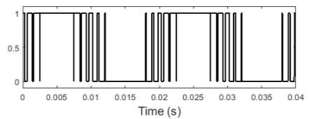
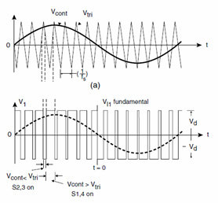
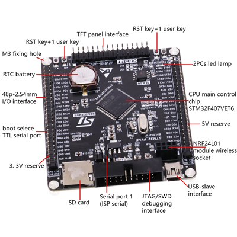
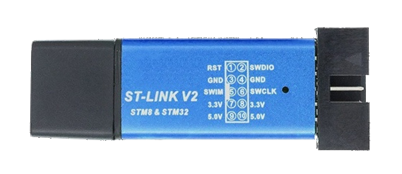
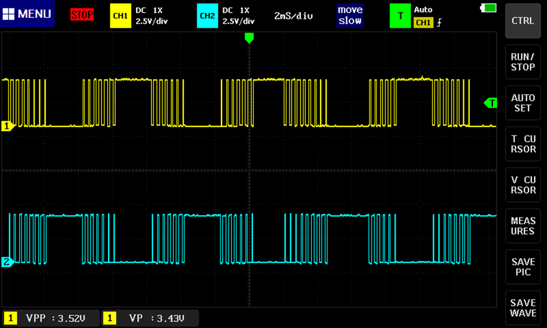

# SPWM waves generation with STM32 microcontroller

## Porpuse 
For building an SPWM Voltage Inverter, it is necessary to generate SPWM signals, either by comparing sines with triangle signals by using analog circuits such as Operational Amplifiers, or generating them with specialized microcontrollers, such as STM32.
<!-- Incluir una imagen más profesional de cómo debe de ser una señal SPWM -->

<!-- Complementar y pulir -->
### Operating Principle
An SWPM signal is generating when comparaing both a sine with a triangle signal. This signal eliminitates/reduces harmonics that afects the proper funcioning of Alternating Current (AC) equipments. Prueba, review [Operating Principle](#operating-principle).


However, some STM32 microcontrollers

### Parameters of design
Modulation Frequency Index $m_{f} = 366$ 
Modulation Amplitud Index $m_{a} = 0.8 ≤ m_a ≤ 0.95$
Carrier Frequency $c_{f} = 21.96 KHz$ 

### Methodology
The microcontroller used is the **STM32F407VET6**


And the programmer **ST-LINL V2** 


The programming will be performed using **STM32CubeIDE**

```c title="main.c" linenums="1"
void HAL_TIM_PWM_MspInit(TIM_HandleTypeDef* htim_pwm) {
    if(htim_pwm->Instance == TIM1) {
        __HAL_RCC_TIM1_CLK_ENABLE();
    }
}
```

### Results


<!-- Cosas que puedo añadir más adelante para que mi portafolio se vea más pro -->

!!! info "Nota de prueba"
    Mensaje de alguna nota o información.

!!! warning "Precaución"
    Mensaje de advertencia.

!!! danger "Peligro"
    Riesgo de daño en hardware.

!!! success "Completado"
    Prueba exitosa.

!!! tip "Consejo"
    Buena práctica de diseño.

!!! question "Duda común"
    ¿Cómo se configura el puerto?
    
| Parámetro | Valor nominal | Condición de prueba |
| :--- | :--- | :--- |
| Frecuencia PWM | 21.96 kHz | Carga de prueba |
| Voltaje de bus | 48 VDC | Entrada nominal |
| Corriente máxima | 7 A | Salida RMS |

=== "main.c"
    ```c
    // Código principal de configuración
    ```

=== "config.h"
    ```c
    // Definiciones y macros
    ```

- [x] Cálculo analítico de componentes pasivos
- [x] Simulación esquemática en Altium Designer
- [ ] Pruebas de integración en banco físico

El diseño cumple con los criterios de la norma[^1].

$$
V_{\text{rms}} = m_a \cdot \frac{V_{dc}}{2 \sqrt{2}}
$$

[^1]: Referencia específica a la norma aplicable para validación de sistemas embebidos.